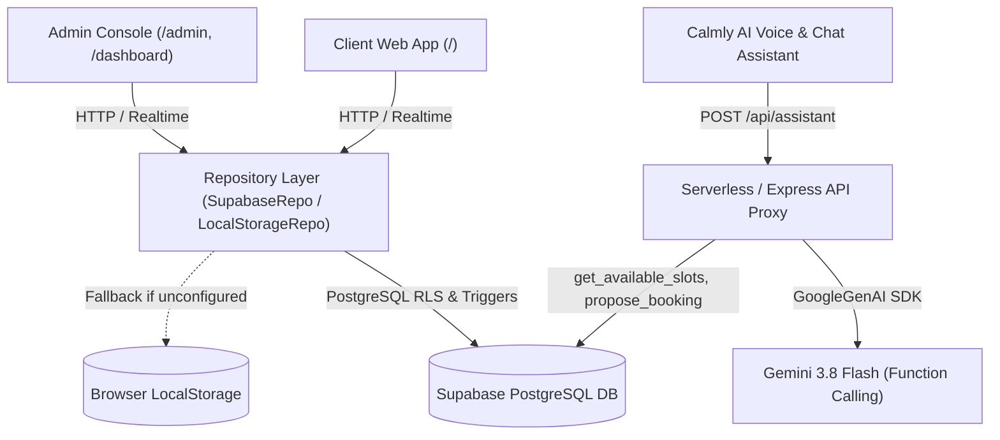

# Calmly — Private Nutritionist Practice & Booking Platform

Calmly is a two-sided appointment scheduling and practice management web application built for a private clinical nutritionist and her clients. It solves the critical healthcare scheduling challenge where 1 in 4 clients fail to attend consultations without prior notice.

## Architecture & System Overview

## Key Features

### Client Experience (`/`)
- **Next Appointment Hero Card**: Prominently displays the client's next confirmed consultation with live countdown (e.g. "in 2 days", "tomorrow"), one-tap attendance confirmation ("Confirm I'm coming"), direct cancellation dialog, rescheduling, and .ics calendar export in `Asia/Kolkata` timezone.
- **3-Step Booking Wizard (`/book`)**:
  1. 60-day interactive date selector strip.
  2. 30-minute slot selector partitioned into Morning (09:00–11:30), Afternoon (12:00–15:30), and Evening (16:00–17:30) with taken and past slots disabled.
  3. Client details form with inline phone format validation (`^[6-9][0-9]{9}$`), optional Visit format (In-clinic vs Video call), goal selection chips, and an invisible honeypot field for bot mitigation.
- **Waitlist on Full Days**: When all slots on a requested day are booked, clients can immediately join the day's waitlist.
- **My Appointments (`/appointments`)**: Tabs for Upcoming and Past consultations with status tags, cancellation, and rescheduling.
- **Client Identity**: Device phone identity stored in `localStorage` with a "Switch" link; zero account/password friction.
- **Mobile First**: Built with `100dvh`, fixed bottom tab bar respecting `env(safe-area-inset-bottom)`, and input font size $\ge 16\text{px}$ to prevent mobile zoom.

### No-Show Mitigation & Practice Admin (`/admin`, `/dashboard`)
- **Real-Time Attendance Confirmation**: One-tap "Confirm I'm coming" sets `confirmed_at` and reflects immediately in the admin console.
- **At-Risk Flagging**: Unconfirmed bookings scheduled within 24 hours are automatically marked with an animated "At Risk" warning.
- **Direct WhatsApp Messaging**: Every appointment row features a direct `wa.me/91XXXXXXXXXX?text=...` link pre-populated with appointment date, time, and confirmation link (`/?confirm=<id>`).
- **Tomorrow's Reminders Modal**: Bulk action modal reviewing all unconfirmed consultations for the next calendar day.
- **Repeat No-Show Detection**: Automatically flags clients who have missed 2 or more consultations.
- **Needs Update Flag**: Booked appointments whose time has elapsed are highlighted to prompt the nutritionist to record session outcome (Done vs No-show).
- **Rule-Based Risk Score**: Evaluates booking lead time, unconfirmed status, and historical attendance into a Low/Medium/High risk chip with explanatory tooltips.
- **Strict No-Show Metric**: Calculated as $\frac{\text{No-show}}{\text{Done} + \text{No-show}}$ across all non-cancelled sessions.
- **Waitlist Slot Re-allocation**: When an appointment is cancelled, the admin is offered a "Slot freed" drawer with direct WhatsApp links to notify waitlisted clients.
- **Dashboard Safety**:
  - Confirmation dialog before Cancel and before reverting a Done or No-show appointment back to Booked.
  - Inline status editor with a 5-second Undo toast.
  - CSV export with defense against spreadsheet formula injection (`=`, `+`, `-`, `@` prefixing).
  - Appointments can never be deleted through the app; cancellations are tracked status updates.

### AI Booking & Clinic Assistant
- **Server-Side Gemini Integration**: Accesses Gemini models strictly through the server-side proxy `/api/assistant` using the `@google/genai` TypeScript SDK. The Gemini API key is never exposed to client bundles.
- **Strict Function Calling**:
  - `get_available_slots(date)`: Queries free slots for any date within 60 days.
  - `get_my_next_appointment()`: Uses phone stored securely on the device.
  - `propose_booking(name, phone, date, time, goal, visit_type)`: Validates availability and rules without writing to the database.
- **Confirm-Before-Book Safety**: Assistant proposals are rendered as interactive Confirmation Cards. Database writes only occur when the user explicitly taps "Confirm & Book".
- **Voice Capabilities**: Speech recognition via browser `SpeechRecognition` API with language toggle (`en-IN` / `hi-IN`) and text-to-speech reply readout via `speechSynthesis`.
- **Guided Fallback Mode**: If the server-side assistant or Gemini API key is unavailable, the UI automatically transitions to an in-chat guided quick-reply booking flow with zero error screens.

---

## Environment Variables & Secrets

Configure in Vercel **Environment Variables** or AI Studio **Secrets**:

### Client Bundle (Vite)
| Variable | Description | Example |
|---|---|---|
| `VITE_SUPABASE_URL` | Supabase project URL | `https://xyzcompany.supabase.co` |
| `VITE_SUPABASE_ANON_KEY` | Public anon key (never secret key) | `eyJhbGciOiJIUzI1NiIsInR5c...` |

### Server Runtime (`server.ts` / `api/assistant.ts`)
| Variable | Description | Example |
|---|---|---|
| `GEMINI_API_KEY` | Google Gemini API key | `AIzaSy...` |
| `GEMINI_MODEL` | Gemini model alias | `gemini-3.8-flash` |
| `SUPABASE_URL` | Server-side Supabase URL | `https://xyzcompany.supabase.co` |
| `SUPABASE_ANON_KEY` | Server-side Supabase anon key | `eyJhbGciOiJIUzI1NiIsInR5c...` |

> **Safety Rule**: Calmly rejects any key containing `sb_secret` or `service_role` with a descriptive error to protect database service credentials.

---

## Sample Data Cleaning & Normalization

All sample records are parsed through `src/lib/normalize.ts` and seeded via `seedInitialData`:

| Raw Input | Client Name | Cleaned Phone | Cleaned Date | Cleaned Time | Status | Seed Key |
|---|---|---|---|---|---|---|
| `Riya Shah \| 98200 11111 \| 24/10/2026 \| 10:00` | Riya Shah | `9820011111` | `2026-10-24` | `10:00` | Booked | `seed-1` |
| `Arjun Mehta \| 98200 22222 \| 2026-10-24 \| 11:30am` | Arjun Mehta | `9820022222` | `2026-10-24` | `11:30` | Booked | `seed-2` |
| `Riya Shah \| 9820011111 \| 25-10-2026 \| 4 pm` | Riya Shah | `9820011111` | `2026-10-25` | `16:00` | Booked | `seed-3` |
| `Meera Iyer \| (no phone) \| 23/10/2026 \| 09:00` | Meera Iyer | `null` (No phone) | `2026-10-23` | `09:00` | Done | `seed-4` |
| `Kabir Rao \| 98200 33333 \| 22/10/2026 \| 14:00` | Kabir Rao | `9820033333` | `2026-10-22` | `14:00` | No-show | `seed-5` |

- Riya Shah's phone variants (`98200 11111` and `9820011111`) resolve to a single client key: `phone:9820011111`.
- Meera Iyer has no phone; the UI displays "No phone on file" with an inline "+ Add phone" action without crashing.

---

## Assumptions & Security Limitations

1. **Open RLS & Admin Link**: Per the client assignment brief, the application operates with an open admin link without password authentication. While row-level security and triggers enforce phone formatting, 60-day limits, and double-booking prevention, full multi-tenant isolation requires Supabase Auth or role-based tokens.
2. **Phone-Based Identity**: Client bookings are associated with the mobile number stored on their device's local storage. Clients can freely change this number via the "Switch" action.
3. **WhatsApp Dispatch**: WhatsApp reminders rely on pre-filled `https://wa.me/` URLs launched in a new tab, requiring manual dispatch by the nutritionist.
4. **Speech Recognition Support**: Web Speech API (`SpeechRecognition`) is natively supported on Chrome, Edge, and Safari; unsupported browsers automatically hide the microphone toggle.

---

## Image Credits & Generation

All imagery is produced specifically for this application and stored locally in `/public/images/`:
- `hero_clinic_exterior.jpg`: Modern wellness clinic exterior at golden hour (generated using `generate_image`).
- `clinic_consultation.jpg`: Nutritionist consultation room with warm oak finishes and natural daylight.
- `healthy_meals.jpg`: Wholesome balanced food bowls on clean stone countertop.
- `kitchen_scale.jpg`: Digital food scale with fresh apples and almonds on marble.
- `clinic_reception.jpg`: Calming reception lounge with sage green accent wall and natural oak desk.
- Each image is configured with explicit dimensions, fallback gradient containers, and lazy loading.
